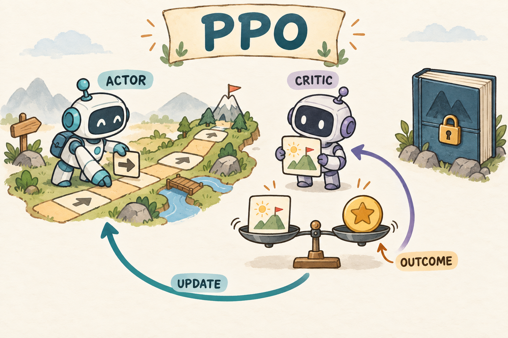
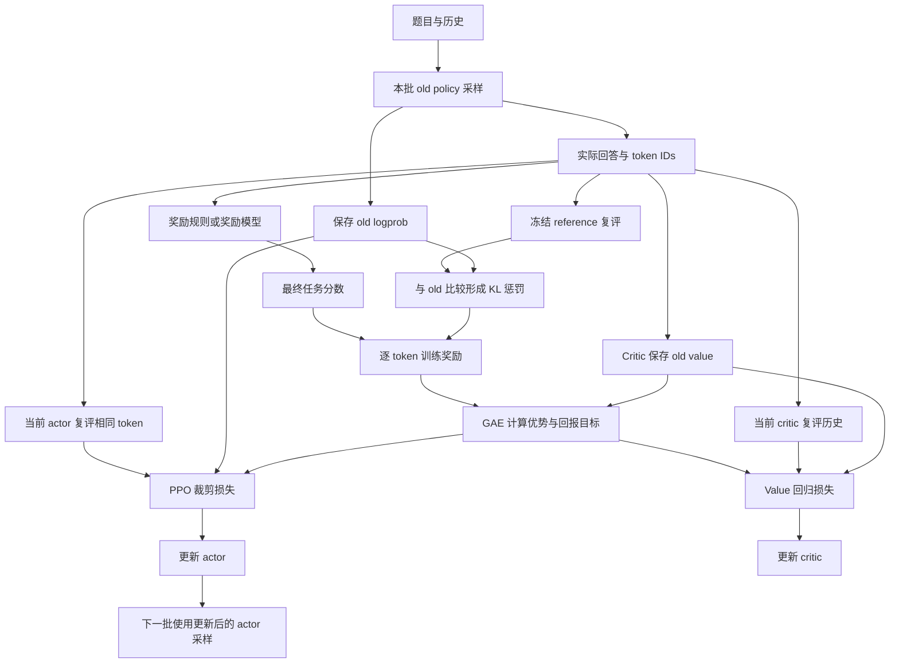

# 02｜PPO：actor-critic、GAE 与裁剪更新

<!-- NAV:TOP:BEGIN -->
[← 上一章：01 智能体强化学习基础](../01-foundations/TUTORIAL.md) · [全书目录](../docs/CHAPTERS.md) · [本篇目录](../docs/families/01-policy-preference.md) · [下一章：03 GRPO：同题采样与组内优势 →](../03-grpo/TUTORIAL.md)
<!-- NAV:TOP:END -->

[学习路线](../docs/LEARNING_PATH.md) · [损失与裁剪基础](../01-foundations/TUTORIAL.md) · [运行说明](README.md)

**本章学习任务：** 走完一次完整的 actor/critic 更新——从任务奖励与 reference 约束，到 GAE 优势与回报目标，再到 policy/value 两项 loss。

PPO 全称 **Proximal Policy Optimization，近端策略优化**。Policy 是“当前情境下如何选择动作”的规则；optimization 是调整规则；proximal 表达更新时不要一下偏离采样策略太远。本章讲常见的 PPO-Clip 版本。它最初用于一般强化学习，后来被用于语言模型训练，方法来源是 [PPO 原论文](https://arxiv.org/abs/1707.06347)。

**你已经具备的前置（来自第一章，不必在这里从零重学）：**

| 概念 | 第一章入口 | 本章如何使用 |
| --- | --- | --- |
| 奖励 ≠ 可直接反传的标签 | [TUTORIAL §5](../01-foundations/TUTORIAL.md) | 任务分数要经优势与 surrogate 进入梯度 |
| old / current、概率比率 ρ | [TUTORIAL §7](../01-foundations/TUTORIAL.md) | 多 epoch 复用同一批 rollout 时必须保留 old |
| PPO 四种裁剪方向 | [TUTORIAL §8](../01-foundations/TUTORIAL.md) | 本章不再从零推导 min/clip，只接到 GAE 产出的优势上 |
| CE / MSE 的训练对象 | [TUTORIAL §2–3](../01-foundations/TUTORIAL.md) | critic 用回归目标；actor 用策略梯度 surrogate |

DPO 不必是本章前置；GRPO 可以在读完本章前先建立“组内优势”直觉，详见 [学习路线](../docs/LEARNING_PATH.md)。

本章用“3 盒笔，每盒 6 支，共多少支”贯穿讲解，答对得 1，答错得 0。你只需要知道模型会给下一个 token 分配概率；token 是分词器使用的文字单位，不一定是一个汉字。接下来先分清角色，再将最终分数变成每步学习信号，最后用一条完整 batch 把数字串起来。读完应能自己走完一次“生成 → 评分 → 算优势 → 更新”。

## 1. 只有一个最终分数，为什么需要这么多步骤

模型偶然写出“3×6=18”，得到了 1 分。最朴素的想法是提高这段回答的概率，但立即遇到三个问题。

第一，分数属于整段回答，模型却逐 token 做选择。早先写出的“3×6”没有即时奖励，我们需要把后来的结果传回早先的动作，这叫**信用分配**。

第二，相同分数是否值得大力鼓励，取决于原先能做到什么。几乎总能答对的题再次答对，与很难的题终于答对，信息量不同。我们想知道这个动作比平常的选择好多少，这叫**优势**（advantage）。一次回答的结果与预期之差，可以用来估计优势。

第三，一次答对可能有偶然性。如果反复用少量样本把某些概率放大几十倍，原有行为可能被破坏。PPO 裁剪目标用来减少过度更新的激励。

因此下面先介绍谁生成、谁评分、谁预测，再算优势，最后控制更新。Actor-critic 是角色分工，GAE 是优势估计方法，PPO clipping 是策略更新规则，三者不是同一个概念。

## 2. Actor、critic、reward、old 和 reference 各做什么



上图画出 actor 选动作、critic 给状态估值的关系。下面的流程图进一步标出 old policy 如何留下采样概率，以及冻结的 reference 如何影响训练奖励。

| 角色 | 输入和输出 | 何时改变 |
| --- | --- | --- |
| Actor，当前策略 | 题目与已有回答 → 下一 token 的概率 | 每次策略优化时更新 |
| Old policy，行为策略 | 生成本批回答，留下当时所选 token 的概率 | 下一批刷新；批内保存值固定 |
| Reward，奖励来源 | 完整回答 → 实际任务分数 | 本章答案校验器是固定规则 |
| Critic，价值模型 | 某一步之前的历史 → 之后回报的预测 | 用本批回报目标训练 |
| Reference，参考策略 | 对相同 token 复评 → 固定的概率基准 | 本章全程冻结 |

Old 不一定要长期保留独立网络，保存生成时的 logprob 就能提供比率分母。Reference 用于约束相对于开训起点的长期偏离。二者开训时可能相同，后面职责和数值不同。Critic 输出回报估计，reference 输出 token 概率，也不能互换。



箭头表示数据流，不全是可导路径。采样结果、奖励、reference、old 概率与优势作为固定数据使用；当前 actor 的评分和当前 critic 的估值才反传。一般环境控制 PPO 不一定有 reference 或 KL 奖励；这两项属于本章的语言模型设置。

## 3. 把写回答拆成状态、动作、奖励与回报

角色清楚了，但 critic 在哪些位置估值尚未定义。为此先将回答拆成按时间排列的决策过程。

时刻 t 的**状态** $`s_t`$ 用“题目 + 已生成前缀”表示；**动作** $`a_t`$ 是下一个 token；**策略** $`\pi_\theta(a_t\mid s_t)`$ 是模型给这个选择的概率，$`\theta`$ 表示模型参数。接上 token 后得到下一状态。机器人可将状态换成传感器读数、动作换成电机指令，接口类似，但不是相同任务。复杂 agent 的历史也未必包含真实世界全部信息。

**奖励 reward** $`r_t`$ 是当前一步的反馈，**回报 return** $`G_t`$ 是从此刻开始未来奖励的折扣和：

```math
G_t=r_t+\gamma r_{t+1}+\gamma^2r_{t+2}+\cdots.
```

$`\gamma`$ 叫折扣因子，通常在 0 到 1 之间。取 1 不打折，取 0.9 则晚一步的奖励计 0.9 倍。两步奖励 `[0,1]` 且 gamma=1 时，第一步即时奖励为 0，但回报为 1，因此早先的动作也有可学习的结果。

Critic 的 $`V_\phi(s_t)`$ 预测从该历史继续按策略行动的平均回报。它没提前看到未来答案。$`\phi`$ 表示 critic 参数，以区别 actor 的参数。单次预测会出错，训练要让预测接近经历中构造的回报目标。

## 4. 先将 reference 约束放进奖励

现在知道回报来自奖励，便能解释 reference 为什么出现在 GAE 之前。只有任务分数时，策略可能为了得分明显偏离原来的语言行为。LLM PPO 常在逐 token 奖励中加入 reference 偏离惩罚，再用合成奖励估计优势。

KL 全称 **Kullback–Leibler divergence，KL 散度**，衡量分布差异。这里没有逐项遍历整个词表，而是在 old policy 实际采到的 token 上计算 logprob 差。$`\ell_t^{old}`$、$`\ell_t^{ref}`$ 表示相同历史、相同 token 的两份对数概率：

```math
\widetilde r_t=-\beta(\ell_t^{old}-\ell_t^{ref})+
\mathbf{1}[t=\text{最后有效 token}]R_{task}.
```

$`R_{task}`$ 是任务分数，$`\beta`$ 控制偏离惩罚，指示符 $`\mathbf{1}`$ 在条件成立时取 1，否则取 0。每步都有可能获得 KL 修正，最后一步再加任务奖励。

例如 old 给实际 token 概率 0.4，reference 给 0.2，则 log-ratio 为 $`\log2\approx0.6931`$。beta=0.1 时奖励修正为 -0.06931。单个采样项也可能为负；KL 非负是分布期望的性质，并非每个 token 都成立。语言模型的角色关系可参考 [Nathan Lambert 的 RLHF 教材](https://rlhfbook.com/c/06-policy-gradients)。

后面为方便手算会直接给出奖励数组。实际 verl PPO 先完成上述合成，再做 GAE，actor loss 不会再加一份相同的 KL。不同后端的配方应分别核对。

## 5. 优势：这次结果比原先预期好多少

回到买笔题。假设只在答对时得 1 分，暂时把 KL 惩罚设为零。如果到了某个前缀，critic 估计接下来平均能得 0.2 分，而这次答对得了 1 分，那么这次回答比预期多得了 0.8 分。这是**一次经历给出的优势估计**。要问某个动作平均比其他选择好多少，还需要考虑同一前缀可能产生的其他回答。

理想动作优势定义为 $`A^\pi(s,a)=Q^\pi(s,a)-V^\pi(s)`$。$`Q^\pi(s,a)`$ 问的是“现在指定这个动作，以后都按策略 $`\pi`$ 行动，平均能得多少回报？” $`V^\pi(s)`$ 问的是“从现在起，连第一个动作也交给策略选择，平均能得多少？” 两个平均值都已知时，直接相减就得到了优势。PPO 采样得到的是具体的动作、奖励和后继状态，critic 给出价值的近似，所以训练需要从这些量**估计**那个差值。

为什么可以减去状态基线？在同一个状态，每种动作都减去相同的数 $`b(s)`$。对策略抽到的动作取平均，基线对标准策略梯度的贡献是零，因为所有动作的概率之和恒为 1。

```math
\sum_a \pi_\theta(a\mid s)\,\nabla_\theta\log\pi_\theta(a\mid s)\,b(s)
= b(s)\,\nabla_\theta\sum_a\pi_\theta(a\mid s)=0.
```

这里把基线当作固定数值参与 actor 更新。式中的 $`\nabla_\theta`$ 表示对策略参数求梯度。合适的基线能减小有限样本的波动。回答才写了一步时，我们还没有看到最后得了几分。此时能拿什么和基线比较？[Spinning Up 的策略梯度推导](https://spinningup.openai.com/en/latest/spinningup/rl_intro3.html#baselines-in-policy-gradients)

<a id="gae"></a>

## 6. GAE：先理解 TD，再把多步误差传回来

**可以在动作刚做完时就算出一个优势估计。** 做完动作后，你知道了这一步实际得了多少奖励，也知道了接下来所在的状态。用这两件事更新对总回报的预期，就是一步**时序差分**（Temporal Difference，TD）。**广义优势估计**（Generalized Advantage Estimation，GAE）进一步利用同一段经历中后面几步带来的修正。先看一步能算出什么，再看为什么值得等到后面。

### 一步 TD 能当场算出什么

根据 Bellman 关系，$`Q^\pi(s_t,a_t)=\mathbb E[r_t+\gamma V^\pi(s_{t+1})\mid s_t,a_t]`$。意思是，选定当前动作后的平均回报，可以拆成当步奖励和下一状态的折扣价值，再对可能的结果取平均。一次转移给了我们这个平均中的一个样本。令 $`V_t`$ 是采样时 critic 对 $`s_t`$ 保存的估值，就能直接计算下面这个差值。

```math
\widehat A_t^{(1)}=\delta_t=r_t+\gamma V_{t+1}-V_t.
```

按时间看，$`V_t`$ 是**动作前**对剩余回报的预测，$`r_t`$ 是**刚做这一个动作**收到的奖励，$`V_{t+1}`$ 是**动作后**对剩余回报的预测。更早的奖励已经落定，不计入从 $`t`$ 出发的回报。如果动作使任务真正结束，取 $`V_{t+1}=0`$。用预测值补上还没有观察到的回报，称为**自举**（bootstrapping）。“剩余估计奖励”就是这里对未来的预测。只要有这一次转移和两次估值，一步 TD 就能算出来。

如果 critic 恰好给出 $`V^\pi`$，那么在给定 $`s_t,a_t`$ 后对奖励和后继状态取平均，$`\delta_t`$ 的期望就是 $`A^\pi(s_t,a_t)`$。一次采样仍可能偏离平均。如果动作前的估值准确，但 critic 总是低估动作后的状态，一步 TD 就会系统性地低估这次选择。把许多使用同一 critic 的样本取平均，这部分偏差仍可能存在。

### 同一次成功，三种方法怎样给第一步打分

看一个只有两个动作的任务。智能体先**修改代码**，再**运行测试**。这次测试通过，任务真正结束。两步奖励依次是 `[0, 1]`，取 $`\gamma=1`$。假设 critic 在修改前和修改后都预测 0.20 分。因此 $`\delta_0=0+0.20-0.20=0`$，$`\delta_1=1+0-0.20=0.80`$。第一步的一步优势为零，原因是中间没有发奖，critic 也没有调高预测。这个零值本身无法判断修改是否有用。

如果等到测试结束，我们就能直接使用从当前动作到终局的**实际采样回报**（Monte Carlo return，蒙特卡洛回报）$`G_t`$，减去动作前的估值，即 $`\widehat A_t^{MC}=G_t-V_t`$。这次从任一步往后看都收到 1 分，所以两步的 MC 优势都是 0.80。要是同样的修改之后，第二步碰巧选错测试而得 0 分，第一步的 MC 估计就变成 −0.20。**早先动作相同，后续选择不同，估计也会波动**，这就是完整采样回报的方差来源之一。

GAE 用参数 $`\lambda`$ 决定把后续修正传回多少。对一段从 $`t`$ 到 $`T-1`$ 的轨迹，令 $`\widehat A_T=0`$。这里 $`T`$ 是这段数据的终点，$`l`$ 表示向后数几步。从最后一个动作开始，每个位置只需一次乘加。

```math
\widehat A_t=\delta_t+\gamma\lambda\widehat A_{t+1}
=\sum_{l=0}^{T-t-1}(\gamma\lambda)^l\delta_{t+l}.
```

本例最后一步没有后续修正，所以三种算法的第二步都是 0.80。第一步则是 $`0+\lambda\times0.80`$。

| 优势估计方法 | 第一步 · 修改代码 | 第二步 · 运行测试 |
| --- | ---: | ---: |
| 一步 TD（λ = 0） | 0.00 | 0.80 |
| GAE（λ = 0.95） | 0.76 | 0.80 |
| 完整轨迹的 MC（λ = 1） | 0.80 | 0.80 |

从第一步看，一步估计把余下的测试结果交给 critic 预测，两步估计直接用实际测试结果。这里 GAE 的 0.76 恰好是 `0.05 × 0.00 + 0.95 × 0.80`。轨迹更长时，GAE 混合一步、两步、三步直到片段末尾的估计。$`\gamma`$ 决定**晚收到的奖励值多少**，$`\lambda`$ 决定**多大程度用后续经历修正中途的价值预测**。当中间估值有系统误差时，较大的 λ 可以减少对这些估值的依赖。当后续采样很不稳定时，较小的 λ 可以减少它带来的波动。这就是偏差与方差的折中。[Schulman 等，GAE 原论文 §3](https://arxiv.org/pdf/1506.02438#page=4)

### 倒着算，什么时候等于直接减去基线

Rollout 按时间顺序执行。拿到整段数据后从后向前算，是因为相邻位置可以共用后缀的结果，只需遍历一次。**决定是否等于 MC 的是 λ 与轨迹的终点。** 令 $`\lambda=1`$，先展开相邻两项。

```math
\begin{aligned}
\delta_t+\gamma\delta_{t+1}
  &= (r_t+\gamma V_{t+1}-V_t)\\
  &\quad+\gamma(r_{t+1}+\gamma V_{t+2}-V_{t+1})\\
  &= r_t+\gamma r_{t+1}+\gamma^2 V_{t+2}-V_t.
\end{aligned}
```

第一个括号里的 $`+\gamma V_{t+1}`$ 和第二个括号展开后的 $`-\gamma V_{t+1}`$ 正好抵消。沿着同一条轨迹继续展开，所有中间价值都消去，只剩采到的奖励、尾值和起点的基线。

```math
\widehat A_t^{(\lambda=1)}
=\sum_{l=0}^{T-t-1}\gamma^l r_{t+l}+\gamma^{T-t}V_T-V_t.
```

- **任务真的结束。** $`V_T=0`$，上式就是 $`G_t-V_t`$。如果 $`\gamma=1`$ 且只在终局发一次奖励 $`R`$，所有动作的回报目标都是 $`R`$，各自的原始优势为 $`R-V_t`$。
- **只是采样截断。** 如果任务还能继续，$`V_T`$ 取截断处最后状态的 critic 估值。比如只记录了“修改代码”，此时奖励为 0、尾值为 0.20，第一步估计是 `0 + 0.20 − 0.20 = 0`。误把这次切段当终局就会算出 −0.20，相当于给仍有机会成功的状态估了零分。

改为 $`0\lt\lambda\lt1`$ 时，第二个括号乘的是 $`\gamma\lambda`$，中间价值还留下 $`\gamma(1-\lambda)V_{t+1}`$。这就是同样从后往前算，表中的 0.76 和 0.80 却不同的原因。

**把估计接回 PPO。** actor 用优势决定这一步应提高还是降低所选动作的概率。critic 的回归目标是 $`\widehat G_t=V_t+\widehat A_t`$。在 λ = 0.95 的例子里，两个目标是 `[0.96, 1.00]`。如果 actor 更新前要把优势标准化，应先用原始优势构造这两个目标，再标准化给 actor 的那一份。

### 延伸阅读 · Terminal-RSI 的轮次边界

智能体每次调用工具，可能收到几百个观察 token。Terminal-RSI 的 TB-GAE（Turn-Boundary Skip-Observation GAE）只沿模型生成的位置传递误差。观察仍进入下一动作的上下文。同一轮内，折扣和衰减系数都取 1，跨到上一轮时才使用配置的轮间系数。[算法定义，修订版 §2.3](https://arxiv.org/html/2610.22192v3#S2.SS3)

论文初版把 RPR-1 的第一阶段记为标准 GAE，取 $`\gamma=\lambda=1`$。修订版描述为 TB-GAE，作者公开的配置也开启了 TB-GAE，两个轮间系数均为 1。当两种计算使用相同的动作位置、奖励、估值和终点时，前面的抵消仍成立。对只有一笔终局奖励的完整轨迹，每个动作的未折扣目标都是那笔奖励。仅凭这些相同的数值，无法反推出某个检查点采用了哪条代码路径。单独衡量轮次处理的效果需要对照实验。[初版 §2.4](https://arxiv.org/html/2610.22192v1#S2.SS4) · [修订版 §2.4](https://arxiv.org/html/2610.22192v3#S2.SS4) · [作者的 RPR-1 配置](https://github.com/jyyang26/Terminal-RSI/blob/46954f6bd1eadb3187769c033f6a28d12fd796d9/examples/terminal_rsi/configs/harbor_rpr1_fdr.yaml#L14-L16)

## 7. 概率比与裁剪：把第一章的裁剪接到 GAE 优势上

回到 PPO，刚刚算出的 0.76 告诉 actor，这一步应该提高所选动作的概率。如果在同一批回答上更新多次，PPO 怎样控制继续提高概率的激励？生成回答昂贵，PPO 往往对一批样本进行多次小批量更新；第一次之后，当前策略就不同于生成数据的 old policy。比率与导数结构已在 [损失函数详解 §7–8](../01-foundations/TUTORIAL.md) 展开：ρ=exp(ℓ−ℓ_old)，ρ=1 时导数仍可非零；old 必须是采样快照，不能与 current 共图相消。

把前面算出的优势代入裁剪目标即可。**clip 比较原始收益与裁剪收益，取两者中较小的一项。** 未裁剪收益是 $`\rho_t\widehat A_t`$；PPO-Clip 取保守收益再加负号：

```math
L_\pi=-\mathbb{E}_t\left[\min\left(\rho_t\widehat A_t,
\mathrm{clip}(\rho_t,1-\epsilon,1+\epsilon)\widehat A_t\right)\right].
```

为了一次看到四种方向，另取优势 A 为 +1 或 −1，设置 epsilon=0.2。表中的“裁剪收益”是单独算出的 `clip(ρ)A`，最后还要在它和原始收益之间取较小值。

| A | ρ | 原始收益 ρA | 裁剪收益 clip(ρ,0.8,1.2)A | 选中的收益 | loss = −选中项 | 对 current logprob 的导数 |
| ---: | ---: | ---: | ---: | ---: | ---: | ---: |
| +1 | 0.5 | 0.5 | **0.8** | 0.5 | −0.5 | −0.5 |
| +1 | 1.5 | 1.5 | 1.2 | 1.2 | −1.2 | 0 |
| −1 | 0.5 | −0.5 | −0.8 | −0.8 | 0.8 | 0 |
| −1 | 1.5 | −1.5 | **−1.2** | −1.5 | 1.5 | 1.5 |

所以不是“越界就一律零梯度”，也不保证每个概率比最终都留在区间内。共享参数、其他样本和优化器状态仍能改变它。裁剪限制的是这个样本在特定方向的额外激励。

## 7.1 一条完整 batch：奖励 → KL shaping → GAE → 两项 loss

回到买笔题。仍假设回答含两个有效生成位置，第二步答对且真正终止。保留 §6 的估值和终局奖励，这次打开 §4 的 KL 惩罚，看看哪些数值会变。

| 步骤 | 数值 | 来源 / 含义 |
| --- | --- | --- |
| 任务奖励 | R_task=1 | 答案校验器 |
| old value | V_old=[0.20, 0.20] | 采样时 critic 保存 |
| 参考示意 KL | ℓ_old−ℓ_ref = [0.0, 0.2] | 同 token 上 old 相对 reference |
| β | 0.1 | 手算选取的惩罚强度，章节默认配置为 0.02 |
| 合成训练奖励 | r̃=[−0.1×0, −0.1×0.2+1]=[0, 0.98] | §4 公式；任务分落在最后有效 token |
| γ, λ | 1, 0.95 | 与 §6 手算一致 |
| TD 误差 | δ₀ = 0 + 0.20 − 0.20 = 0，δ₁ = 0.98 − 0.20 = 0.78 | 最后状态价值为 0 |
| 优势 | Â₁ = 0.78，Â₀ = 0 + 0.95 × 0.78 = 0.741 | 从第二步算回第一步 |
| value 目标 | Ĝ = [0.20 + 0.741, 0.20 + 0.78] = [0.941, 0.98] | 用**未标准化**优势构造 |
| 策略 loss 输入 | 当前 ℓ 与固定 ℓ_old、Â、response mask | actor 反传 |
| value loss 输入 | 当前 V_φ 与固定 Ĝ（及 old value 裁剪） | critic 反传 |

对应代码阅读顺序：合成奖励与优势标准化见 [verl algorithms](../src/agentic_rl/verl_backend/algorithms.py)；GAE 与 `ppo_loss` 见 [losses.py](../src/agentic_rl/losses.py)。**不要**把已标准化的 A 再加 V_old 当回归目标。

任务奖励只加在最后一个有效 token。如果两步都加同一个 1 分，回报会把一次答对算成两次。KL 修正也应在所选配方中只计一次。

## 8. Critic 怎样学，为什么有第二个 loss

Actor 根据优势改选择，优势又依赖 critic。策略变化后，critic 也必须学习新的回报水平。我们让它接近前面构造的回报目标，最直接的方法是平方误差。

本地显式 PPO 还使用 value clipping：先限制预测相对 old value 的变化，再取两种误差中较大的一个：

```math
V^{clip}=V_{old}+\mathrm{clip}(V_\phi-V_{old},-\epsilon_V,\epsilon_V),
```

```math
L_V=\frac12\mathbb{E}_t\left[\max\left((V_\phi-\widehat G)^2,
(V^{clip}-\widehat G)^2\right)\right],\qquad L=L_\pi+c_VL_V.
```

$`\epsilon_V`$ 是 value 裁剪尺度，$`c_V`$ 是权重。取 max 避免裁剪后的预测提供过分乐观的误差。例如 old value=0.2、当前 value=0.8、目标=1、尺度=0.2，裁剪预测为 0.4，两种平方误差为 0.04 和 0.36，value loss 为 0.18。

Value clipping 是该实现选择，并非定义 PPO 必需的唯一 critic loss。Actor、critic 使用独立参数与优化器时可以分开更新。Old value 和回报目标保持固定，避免同时移动预测与标签。

## 9. 将整轮训练接回真实代码

每个零件现在都有来由了，重新按时间拼装：

1. Actor 生成回答，保存 token IDs、old logprob、old value 与有效位置 mask。
2. 奖励来源判分，reference 复评，构造逐 token 奖励。
3. 从后向前算 GAE，保存优势和 critic 回报目标。
4. 当前 actor/critic 复评同一批 token，计算两项 loss，再反传、优化。
5. 批内更新结束后采下一批；old 基准刷新，reference 保持固定。

Mask 是“哪些位置直接算 loss”的 0/1 标记：题目与 padding（补齐长度的空位）取 0，实际生成取 1。Mask=0 不表示从模型输入删除这些文字。

| 代码入口 | 带着什么问题去读 |
| --- | --- |
| [config.yaml](config.yaml)、[trl_backend.py](../src/agentic_rl/trl_backend.py) | 默认 TRL 路径怎样构造 PPOTrainer、value、reference 和奖励接口 |
| [algorithms.py](../src/agentic_rl/verl_backend/algorithms.py) | KL 与最终任务奖励怎样合并，优势何时标准化 |
| [losses.py](../src/agentic_rl/losses.py) 的 `gae`、`ppo_loss` | 从右向左递推，哪些目标 detach，value 为什么取 max |
| [actor.py](../src/agentic_rl/verl_backend/actor.py) | 当前前向、反传及两类参数更新怎样执行 |

下面四行就是 §6 的反向递推。

```python
delta = rewards[:, t] + gamma * next_value - values[:, t]
carry = (delta + gamma * lam * carry) * live
adv[:, t] = carry
next_value = torch.where(live.bool(), values[:, t], next_value)
```

`carry` 保存右侧已算出的优势，`live` 标记有效生成位置。每行放一条轨迹，尾部可以补齐。完整回答以零尾值结束。如果在可继续的状态切段，应传入该状态的 `bootstrap` 估值。把多个独立任务拼到一行时，需要在每个终局分开递推。

**本仓库的实现范围：** `gae` 支持显式传入 `bootstrap`，但当前 [Native PPO 训练器](../src/agentic_rl/trainers.py) 调用它时没有传入该参数，因此按零尾值递推，不会为可继续的截断自动补上 critic 估值。本章默认的 `backend: trl` 走另一套实现，这个说明只适用于 Native 路径。

装好项目后，可以直接把 §6 的两步例子交给同一个函数。先猜 λ 改成 0.5 时第一步会得多少，再运行这段 Python。

```python
import torch
from agentic_rl.losses import gae

rewards = torch.tensor([[0.0, 1.0]])
values = torch.tensor([[0.2, 0.2]])
mask = torch.ones_like(rewards)
for lam in (0.0, 0.5, 0.95, 1.0):
    advantages, targets = gae(rewards, values, mask, gamma=1.0, lam=lam)
    print(lam, [round(x, 2) for x in advantages[0].tolist()])
```

第一步的输出依次为 0.00、0.40、0.76、0.80。第二步始终是 0.80，因为它后面已经没有动作。

## 10. 先预测，再运行，再解释日志

按 [README](README.md) 安装后，从仓库根目录运行下面的 Linux/WSL 命令。Windows PowerShell 按安装环境改用 `.venv\Scripts\arl.exe`。

**本章默认教学入口与 `config.yaml` 的 TRL 后端一致：**

```bash
# 默认：与本章介绍的 PPOTrainer 路径一致
.venv/bin/arl train 02-ppo/config.yaml --smoke --backend trl
# 等价薄入口（读取同一 config.yaml）
python 02-ppo/train.py --smoke
```

进阶对照（不要在第一次运行时同时学习算法与后端切换）：

```bash
.venv/bin/arl train 02-ppo/config.yaml --smoke --backend native
.venv/bin/arl train 02-ppo/verl.yaml --smoke --verl-workers 2
```

`--smoke` 使用随机微型模型跑少量更新。默认奖励由答案校验器给出，TRL 通过 `reward_model` 接口读取这个分数。

运行前预测：actor、critic 都应有训练路径，reference 不变。运行后一起看任务奖励、value loss、KL、概率比与梯度。Value loss 下降可能只是更准确地预测失败；actor loss 近零可能是正负项数值抵消。能力需要独立题目的自由生成正确率来判断。

默认 TRL 将同一批数据拆成多个 minibatch，进行多轮 PPO 更新。native 把一次更新的计算展开，verl 的奖励合成与优势标准化见 §9 的代码入口。[TRL PPOTrainer 文档](https://huggingface.co/docs/trl/v0.25.1/en/ppo_trainer)

## 11. 新手自测：不用术语也能解释吗

下面是练习。先遮住答案，尝试用自己的话复述，再回到对应小节。

1. **Critic、reward、reference 都在评价，区别是什么？** Reward 给实际任务反馈；critic 预测未来合成回报；reference 提供固定概率基准。预测、判分、约束是三个问题。
2. **GAE 全称是什么，为什么先算 TD？** 广义优势估计；TD 给相邻时间点的价值修正，GAE 将未来修正加权传回当前动作。
3. **两步例子把 λ 改为 0 或 0.5，会发生什么？** 一步 TD 给第一步 0。取 0.5 时，第二步的误差有一半传回，第一步为 0.40。两种设置的第二步都是 0.80。
4. **正优势、old 概率 0.2、当前 0.3、epsilon=0.2，还继续鼓励增加吗？** 该样本落在裁剪平台，不再提供这个方向的额外激励；其他样本仍可能改变其概率。
5. **下一批谁刷新？** Old 用更新后的 actor 形成新基准，reference 固定；critic 随自己的优化更新。
6. **标准化后的优势加 old value 能当 return 吗？** 不能，它改变了单位；回报目标应先由未标准化优势构造。

## 12. 延伸阅读：每份资料解决一个疑问

- [PPO 原论文](https://arxiv.org/abs/1707.06347)：裁剪 surrogate 与更新流程。
- [GAE 原论文](https://arxiv.org/abs/1506.02438)：lambda 如何连接不同时间尺度。
- [Spinning Up：策略梯度教学](https://spinningup.openai.com/en/latest/spinningup/rl_intro3.html)：减 baseline 的数学理由。
- [Nathan Lambert：RLHF 中的策略梯度](https://rlhfbook.com/c/06-policy-gradients)：一般 RL 与语言模型 reward/reference 的衔接。

下一步：若你已理解 actor/critic 与 GAE，可转到 [GRPO：同题采样与组内优势](../03-grpo/TUTORIAL.md)，看怎样用组内统计替代学习式 critic。需要离线偏好时再读 [DPO](../06-dpo/TUTORIAL.md)。

<!-- NAV:BOTTOM:BEGIN -->
[← 上一章：01 智能体强化学习基础](../01-foundations/TUTORIAL.md) · [全书目录](../docs/CHAPTERS.md) · [本篇目录](../docs/families/01-policy-preference.md) · [下一章：03 GRPO：同题采样与组内优势 →](../03-grpo/TUTORIAL.md)
<!-- NAV:BOTTOM:END -->
