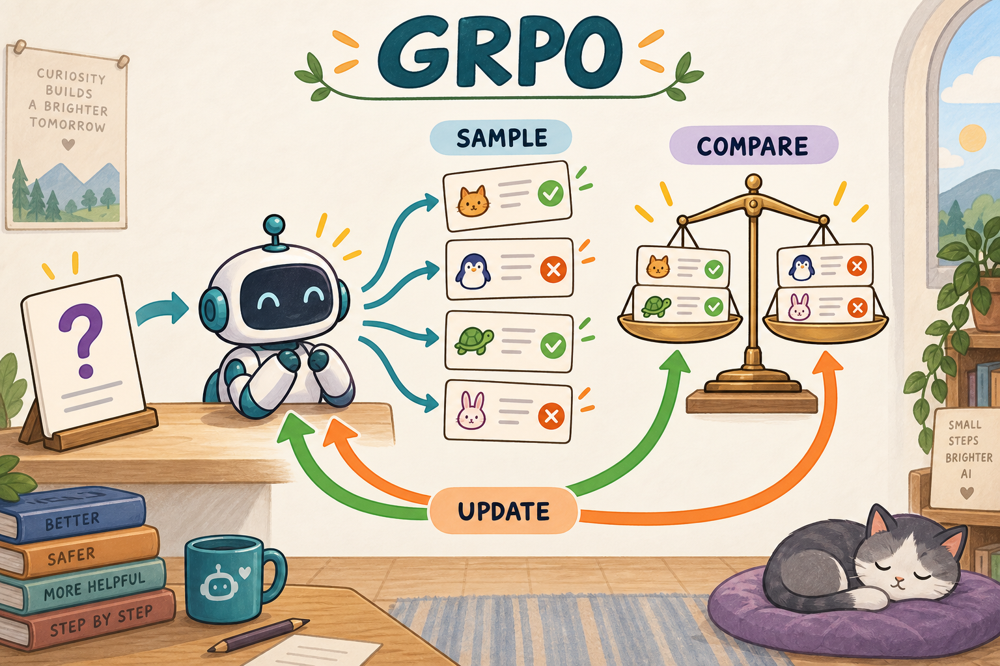
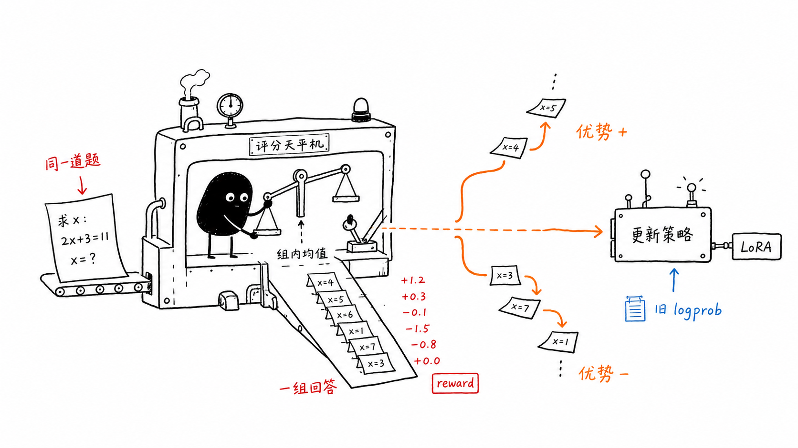

# 03｜GRPO：同题采样与组内优势

<!-- NAV:TOP:BEGIN -->
[← 上一章：02 PPO：actor-critic、GAE 与裁剪更新](../02-ppo/TUTORIAL.md) · [全书目录](../docs/CHAPTERS.md) · [本篇目录](../docs/families/01-policy-preference.md) · [下一章：04 DAPO：动态采样、裁剪与长度处理 →](../04-dapo/TUTORIAL.md)
<!-- NAV:TOP:END -->

[学习路线](../docs/LEARNING_PATH.md) · [损失与裁剪基础](../01-foundations/TUTORIAL.md) · [PPO（推荐前置，非强制）](../02-ppo/TUTORIAL.md) · [运行说明](README.md)

**本章学习任务：** 彻底理解 GRPO（Group Relative Policy Optimization，组相对策略优化）的诞生背景与核心机制——为什么大语言模型在数学与逻辑推理中可以**完全舍弃庞大的 Value Critic 网络**，转而通过“同题多次采样 + 组内相对打分”提供基准，并顺畅打通“采样 → 校验 → 组内标准化 → 裁剪更新”的完整算法与代码数据链路。

---

假设你让大模型解答一道小学数学题：“每盒有 6 支笔，买 3 盒一共有多少支？”

如果模型只尝试了一次，偶然生成了“9”（回答错误，任务得分 0），这个单一信号只能粗暴地告诉你“这条路径不对”，但无法指导模型在哪个决策分叉口走错了。

但如果让当前策略对同一道题同时尝试 4 次，其中两次算出了“18”（得分 1），两次算出了“9”或“12”（得分 0）。此时，我们便能在**完全相同的题目难度与上下文中**，让这 4 份回答同台竞技：高出平均水平的回答获得正向激励，低于平均水平的回答获得负向抑制。这就是理解 GRPO 最直观、最自然的起点。



这一优雅思想最初由 DeepSeek 团队在 [DeepSeekMath: Pushing the Limits of Mathematical Reasoning in Open Language Models](https://arxiv.org/abs/2402.03300) 论文中系统提出，并在后续引发全球推理模型浪潮的 **DeepSeek-R1-Zero** 与 **DeepSeek-R1** 中大放异彩，成为大模型自主探索出长思维链（Long Chain-of-Thought）与顿悟反思能力（Aha Moment）的基石算法。

---

## 1. 为什么需要 GRPO？从 PPO 的“四模型困境”谈起

在第 02 章中，我们学习了经典的近端策略优化（PPO）。PPO 是一套非常成熟的 Actor-Critic 强化学习框架。但在大语言模型后训练（Post-Training）场景下，标准的 PPO 面临着两个极其沉重的工程与算法瓶颈：

### 痛点一：极度高昂的显存与计算开销（四模型之重）
在标准的 LLM-PPO 训练中，显存中通常需要同时驻留或交互 **4 个模型**：
1. **Actor（策略模型）**：负责根据 Prompt 生成 Token，需要反向传播与优化器更新（可训练）。
2. **Critic（价值模型）**：负责估计每个 Token 状态的预期回报 $`V(s)`$，其参数规模通常与 Actor 相当，也需要反向传播与优化器更新（可训练）。
3. **Reference Policy（参考模型）**：提供长期行为基准，用于计算 KL 散度防止策略崩溃（冻结）。
4. **Reward Model（奖励模型）**：给完整生成内容打分（冻结或外部裁判）。

这意味着如果我们要用强化学习训练一个 7B 或 70B 的 Actor 模型，就必须同时部署一个同等量级且占用大量优化器状态显存的 Critic 模型！这对于大多数算力预算有限的团队来说，门槛极其高昂。

### 痛点二：Token 级价值估计在可验证推理（RLVR）中的水土不服
数学证明、代码编写、逻辑谜题等推理任务，天然具备**可验证奖励（Reinforcement Learning with Verifiable Rewards, RLVR）**的特性：只有最终答案对与错，评判函数通过规则脚本（如执行单元测试或提取数值比较）就能给出确定的 0 或 1。

在整段文字末尾才产生一个真实分数的场景下，强行训练一个 Critic 网络去精准预测前缀每一步的 Token 价值，往往会引入极大的估计方差与训练噪声。

### 对齐原文：DeepSeekMath 的破局之道
正如 DeepSeekMath 原文 §4.1.1 明确指出的：
> *"GRPO foregoes the value model, instead estimating the baseline from group scores, significantly reducing training resources. As the value function employed in PPO is typically another model of comparable size as the policy model, it brings a substantial memory and computational burden... GRPO calculates relative advantage by comparing outputs within the same group."*

GRPO 的杀手锏正是：**彻底拿掉 Critic 价值模型！** 它用同题采样的“组内平均水平”作为基线（Baseline），将硬件资源的消耗直接砍半。

> [!NOTE]
> **高质量博客引述 · Sebastian Raschka 的直观解读**  
> AI 学者 Sebastian Raschka（*The State of Reinforcement Learning for LLM Reasoning*）曾形象地阐释：*“在可验证推理任务中，我们不需要事先猜测每句话的价值。让模型自己扮演自己的参照系——在同一题下采样多个回答并进行组内标准化比较，模型就能天然识别出好坏差异。正是这种轻量化的优势，使得纯强化学习（Pure RL）在没有任何 SFT 冷启动的情况下探索出长链推理成为可能。”*

---

## 2. 架构对比：PPO vs GRPO

先通过一张架构对比表，理清 GRPO 相对 PPO 到底砍掉了什么、保留了什么：

| 机制维度 | PPO（第 02 章） | GRPO（本章） | 为什么这样设计 |
| :--- | :--- | :--- | :--- |
| **可训练网络** | **2 个**（Actor 策略 + Critic 价值） | **仅 1 个**（Actor 策略） | 砍掉 Critic，显存与参数梯度计算直接节省近半 |
| **优势来源** | Critic 状态估值 + GAE 多步递推 | **同题 G 条回答的奖励组内标准化** | 用群组统计提供 Baseline，消除时序差分拟合方差 |
| **采样方式** | 通常每题采样 1 条轨迹（或少量） | 每题同时采样 $`G`$ 条候选回答（Group Rollout） | 必须同题采样多条，组内统计与相对比较才有意义 |
| **概率比率 $`\rho`$** | $`\rho_t = \exp(\ell_t - \ell_t^{old})`$ | 相同形式，保留采样旧概率作为基准 | 多步小批量复用数据时，必须修正重要性分布偏差 |
| **策略裁剪** | $`\min(\rho A, \mathrm{clip}(\rho)A)`$ | 相同 PPO 裁剪形式（代入组优势 $`A_i`$） | 限制单次更新过激，保障策略稳定性 |
| **KL 散度正则** | 常见做法：折入逐 Token 奖励 $`\widetilde r_t`$ | **直接加入总 Loss 目标中** | 不污染组优势 $`A_i`$ 的数值尺度，形式更干净 |

### 核心工作流：评分天平机的直观心智模型

知乎与社区技术博主（如猛猿在图解大模型 RL 系列中）常用“天平机”来形容 GRPO 的组内归一化过程：



1. **同题进料**：输入同一个问题 $`q`$。
2. **多重采样**：Actor 自主采样生成一组（例如 $`G=4`$ 条）不同的回答 $`\{o_1, o_2, o_3, o_4\}`$。
3. **确定性判分**：答案校验器（Verifier）对每条回答打分，得到奖励 $`R = \{R_1, R_2, R_3, R_4\}`$。
4. **天平归一（组内均值做支点）**：
   * 比组平均分高的回答，优势为正（获得正激励，提高其生成概率）；
   * 比组平均分低的回答，优势为负（获得负惩罚，压低其生成概率）；
   * 优势直接广播给该回答的所有生成 Token。
5. **策略更新**：利用带 PPO 裁剪的目标函数更新 Actor 权重，下一轮采样再基于更新后的策略展开。

---

## 3. GRPO 的数学目标函数与三大积木

对齐 DeepSeekMath 论文 §4.1.1（Eq. 1 ~ 3），GRPO 的优化目标函数可以完整书写为：

```math
\mathcal{J}_{GRPO}(\theta) = \mathbb{E}_{\substack{q \sim P(Q), \\ \{o_i\}_{i=1}^G \sim \pi_{\theta_{old}}}} \left[ \frac{1}{G} \sum_{i=1}^G \frac{1}{T_i} \sum_{t=1}^{T_i} \left( \min\left( \rho_{i,t} \widehat{A}_i,\; \mathrm{clip}(\rho_{i,t}, 1-\epsilon_l, 1+\epsilon_h) \widehat{A}_i \right) - \beta D_{KL}(\pi_\theta \parallel \pi_{ref}) \right) \right]
```

初学者面对这个长公式往往容易望而生畏，但实际上它是由**三块简单的积木**搭成的：

### 积木一：组内相对优势（Group Relative Advantage）$`\widehat{A}_i`$
对于给定的问题 $`q`$ 和其采出的 $`G`$ 条回答，我们先通过校验函数拿到对应的标量奖励 $`\{R_1, R_2, \ldots, R_G\}`$。随后计算组内均值 $`\bar{R}`$ 和总体标准差 $`\sigma`$：

```math
\bar{R} = \frac{1}{G}\sum_{i=1}^G R_i,\qquad \sigma = \sqrt{\frac{1}{G}\sum_{i=1}^G (R_i - \bar{R})^2}
```

每条回答 $`o_i`$ 的归一化优势计算为：

```math
\widehat{A}_i = \frac{R_i - \bar{R}}{\sigma + \varepsilon}
```

其中 $`\varepsilon = 10^{-4}`$ 为微小正数，仅防止分母除以零。

> [!TIP]
> **深入细节 · 为什么必须同题分组？**  
> 假设 Prompt A 是极难的高考压轴题（全组期望得分 0.1），Prompt B 是极简的口算题（全组期望得分 0.9）。如果跨题混合求均值，Prompt A 里历经万难答对一次（得分 1.0）与 Prompt B 随手答对一次（得分 1.0）就会被当成同等贡献。同题组内归一化固定了题目客观条件，只考察模型在同一难关下的**相对探索优劣**。

> [!NOTE]
> **业界研讨 · Nathan Lambert 谈 Dr. GRPO**  
> 在 RLHF 专著（*rlhfbook.com Chapter 6*）中，学者 Nathan Lambert 讨论了 GRPO 的变体：是否必须除以标准差 $`\sigma`$？  
> 在原始 GRPO 中，除以标准差起到了将不同方差题目的优势尺度拉平的作用；而在一些工业界实践（如 Dr. GRPO / GRPO Done Right）中，研究人员发现若只做中心化 $`R_i - \bar{R}`$ 而不除以 $`\sigma`$，往往能让模型在探索波动激烈的题目上保留更大的梯度冲击，两类设计可在本地通过配置 `scale_rewards: true/false` 灵活切换。

### 积木二：Token 级概率比率与 PPO 裁剪保护
语言模型是自回归逐 Token 吐字的，因此序列级优势 $`\widehat{A}_i`$ 最终必须作用在生成位置的各个 Token 上。对于回答 $`o_i`$ 在位置 $`t`$ 生成的 Token：

```math
\rho_{i,t} = \frac{\pi_\theta(o_{i,t} \mid q, o_{i,1:t-1})}{\pi_{\theta_{old}}(o_{i,t} \mid q, o_{i,1:t-1})} = \exp\left( \ell_{i,t} - \ell_{i,t}^{old} \right)
```

其中 $`\ell = \log \pi`$。为了避免策略单次更新步子过大引发坍塌，PPO 裁剪机制登场：

```math
\mathrm{surrogate}_{i,t} = \min\left( \rho_{i,t}\widehat{A}_i,\; \mathrm{clip}(\rho_{i,t}, 1-\epsilon_l, 1+\epsilon_h)\widehat{A}_i \right)
```

* **正优势（$`\widehat{A}_i \gt 0`$）**：好行为被推高。若概率比率已经涨破上界（$`\rho \gt 1+\epsilon_h`$），截断额外奖励，不再盲目追加推力；
* **负优势（$`\widehat{A}_i \lt 0`$）**：坏行为被压低。若概率比率已经跌破下界（$`\rho \lt 1-\epsilon_l`$），截断惩罚，防止概率直接归零导致网络失稳；
* **走错方向**：好行为概率不升反降、或坏行为概率不降反升时，**绝对不截断**，继续提供强有力的纠偏梯度（对应第一章手算）。

### 积木三：KL 散度正则约束与 Schulman $`k_3`$ 估计器
为了防止模型过度追求奖励而发生严重的模式坍塌（如输出无意义的代码、格式复读或 Reward Hacking），引入固定的参考策略 $`\pi_{ref}`$。

DeepSeekMath 将 KL 惩罚项**直接写在 Loss 侧**（而不是像部分 PPO 那样加在 Reward 里面）：
> *"GRPO regularizes by directly adding the KL divergence between the trained policy and the reference policy to the loss, avoiding complicating the calculation of $`\widehat{A}_{i,t}`$."*

为了在采样 Token 上高效估计 KL 散度，本项目与前沿工程（如 TRL 与 DeepSeekMath）均采用了强化学习先驱 **John Schulman (2020)** 在 *Approximating KL Divergence* 中提出的 **$`k_3`$ 估计器**：

令单个 Token 处两模型的对数概率差为 $`d = \ell^{ref} - \ell`$（即 $`\log \frac{\pi_{ref}}{\pi_\theta}`$），逐 Token 的 KL 采样估计值为：

```math
k = \exp(d) - d - 1
```

> [!IMPORTANT]
> **数学直觉 · 为什么使用 $`e^d - d - 1`$？**  
> 朴素的 KL 采样估计是 $`d_{naive} = \ell - \ell^{ref}`$。但单个 Token 采样时，$`d_{naive}`$ 很容易因为随机抽样出现负数，方差巨大，容易使训练指标产生剧烈震荡。  
> 数学上由于对所有实数 $`x`$ 均有 $`e^x \ge x + 1`$，因此 $`e^d - d - 1 \ge 0`$ **处处恒非负**！  
> 当策略没有偏离参考模型时（$`d \approx 0`$），对 $`e^d`$ 作二阶泰勒展开：  
> $`e^d - d - 1 \approx (1 + d + \frac{1}{2}d^2) - d - 1 = \frac{1}{2}d^2 = \frac{1}{2}(\ell - \ell^{ref})^2`$。  
> 它在零点附近天然平滑且严格非负，具有极低且稳定的估计方差。当配置中设置 `beta: 0.0` 时，该正则项关闭。

---

## 4. 全链路手算：同一组数据如何走到 Loss

为了把上述公式彻底变成看得见、摸得着的数值，我们延续经典的买笔题，做两次完整的手算追踪。

### 场景一：标准区分组（$`G=4`$，奖励 $`R=[1, 1, 0, 0]`$）
假设模型生成了 4 个回答。其中前两条算对（得分 1），后两条算错（得分 0）。
1. **组均值**：$`\bar{R} = (1 + 1 + 0 + 0) / 4 = 0.5`$
2. **总体方差与标准差**：
   $`\sigma^2 = \frac{1}{4}[(1-0.5)^2 + (1-0.5)^2 + (0-0.5)^2 + (0-0.5)^2] = 0.25`$，因此 $`\sigma = 0.5`$
3. **标准化优势**：
   * 回答 0 & 1：$`A = (1 - 0.5) / (0.5 + 10^{-4}) \approx +0.9998 \approx +1.0`$
   * 回答 2 & 3：$`A = (0 - 0.5) / (0.5 + 10^{-4}) \approx -0.9998 \approx -1.0`$

接下来，我们取各回答中的某个代表性 Token，设裁剪系数 $`\epsilon = 0.2`$（比率有效区间为 `[0.8, 1.2]`），追踪它在当前更新步的数值表现：

| 回答编号 $`i`$ | 生成内容片段 | 奖励 $`R_i`$ | 组优势 $`\widehat{A}_i`$ | 采样旧概率 $`p^{old}`$ | 当前概率 $`p`$ | 概率比率 $`\rho`$ | 原始收益 $`\rho \widehat{A}`$ | 裁剪收益 $`\mathrm{clip}(\rho)\widehat{A}`$ | 最终选中的收益 | 对当前 logprob 的导数 |
| :---: | :--- | :---: | :---: | :---: | :---: | :---: | :---: | :---: | :---: | :---: |
| **0** | `18`（短答案） | 1 | **+1.0** | 0.20 | 0.22 | 1.10 | +1.10 | +1.10 | **+1.10** | **-1.10**（继续推高好词） |
| **1** | `3*6=18`（更详细） | 1 | **+1.0** | 0.15 | 0.225 | 1.50 | +1.50 | +1.20 | **+1.20** | **0.00**（已大幅推高，平台截断） |
| **2** | `9`（错误答案） | 0 | **-1.0** | 0.40 | 0.20 | 0.50 | -0.50 | -0.80 | **-0.80** | **0.00**（已大幅压低，平台截断） |
| **3** | `12`（错误答案） | 0 | **-1.0** | 0.25 | 0.375 | 1.50 | -1.50 | -1.20 | **-1.50** | **+1.50**（坏词概率反弹，强烈纠正） |

> [!TIP]
> **关键观察：**  
> * 回答 1 表现优异且已经被较好地推高，触发上限保护，不再过度贪婪更新；
> * 回答 2 是错误答案且已经成功被压低，触发下限保护，防止策略过度萎缩；
> * 回答 3 作为一个错误答案，当前模型的生成概率居然比采样时还高（$`\rho = 1.5`$），模型毫不犹豫地选用了未裁剪的惩罚项（$`-1.50`$），输出高达 $`+1.50`$ 的导数强烈压低该 Token！

### 场景二：退化组（全同奖励）——为什么没有学习信号？
如果这道题太简单，4 个回答全部答对（$`R = [1, 1, 1, 1]`$）；或者题目太难，模型 4 次全错（$`R = [0, 0, 0, 0]`$）：
* 均值 $`\bar{R}`$ 分别为 1.0 或 0.0；
* 每一个回答的分子 $`R_i - \bar{R} \equiv 0`$；
* **所有优势 $`\widehat{A}_i`$ 全部为 0！**

这意味着整个组在 Policy Loss 中的贡献严格为 0。初学者常误以为“答对了 4 次为什么不表扬？”。  
因为强化学习的优势讲究的是**相对差异**。当组内毫无反差时，算法无法判断哪一条思考路径比其它路径更高效、更具鲁棒性。这种组被称为**退化组（Degenerate Group）**。在后续的 [04 DAPO](../04-dapo/TUTORIAL.md) 中，我们将专门学习如何通过动态补采机制识别并排除退化组。

### 场景三：稀疏成功组（难题突破）——GRPO 的重奖机制
假设一道极难的难题，$`G=4`$ 条回答中仅有 1 次侥幸答对，其余 3 次答错（$`R = [1, 0, 0, 0]`$）：
* 组均值：$`\bar{R} = 0.25`$
* 总体标准差：$`\sigma = \sqrt{\frac{1}{4}[(0.75)^2 + 3 \times (-0.25)^2]} = \sqrt{0.1875} \approx 0.4330`$
* 标准化优势：
  * 答对项：$`\widehat{A}_1 = (1.0 - 0.25) / (0.4330 + 10^{-4}) \approx \mathbf{+1.73}`$
  * 答错项：$`\widehat{A}_{2,3,4} = (0.0 - 0.25) / (0.4330 + 10^{-4}) \approx \mathbf{-0.58}`$

**启示**：在普遍答错的逆境中，那次难能可贵的成功回答获得了高达 **+1.73** 的巨大正优势！这解释了为什么 GRPO 具备极强的探索牵引力，能在推理难题中迅速放大微弱的成功火苗。

---

## 5. 顺着真实代码读一遍

本项目在设计上兼顾了“算法底层公式可见性”与“工业框架对接”，提供了三条清晰的代码通路：

| 训练后端 | 对应入口文件 | 核心实现位置 | 适合阅读与学习的目标 |
| :--- | :--- | :--- | :--- |
| **Native（原生 PyTorch）** | `03-grpo/train.py --backend native` | [losses.py](../src/agentic_rl/losses.py) · [trainers.py](../src/agentic_rl/trainers.py) | **逐行精读核心数学**：采样、组归一化、Loss 展开与反传 |
| **TRL（默认教学路径）** | `03-grpo/train.py --backend trl` | [trl_backend.py](../src/agentic_rl/trl_backend.py) | **工业标准实践**：学习 Hugging Face 官方 `GRPOTrainer` 的标准用法 |
| **verl（分布式多 Worker）** | `03-grpo/train.py --backend verl` | [verl_backend/](../src/agentic_rl/verl_backend/) | **多机多卡进阶**：学习 Rollout、DataProto 打包与跨卡全局归一化 |

### 核心代码片段 1：原生组优势计算（[losses.py](../src/agentic_rl/losses.py)）
```python
def group_advantages(rewards, group_size, scale=True):
    # rewards 形状: [batch_size * group_size]
    groups = rewards.reshape(-1, group_size)
    centered = groups - groups.mean(-1, keepdim=True)
    if scale:
        # correction=0 对应总体标准差（除以 G 而非 G-1）
        centered = centered / (groups.std(-1, keepdim=True, correction=0) + 1e-4)
    return centered.flatten().detach()
```
注意末尾的 `.detach()`：优势在当前策略梯度更新中是作为常数输入使用的，绝不参与二次求导。

### 核心代码片段 2：Token 级 Policy Loss 与序列平均（[losses.py](../src/agentic_rl/losses.py)）
```python
delta = logp - old_logp.detach()
ratio = delta.exp()

# PPO 裁剪目标
objective = torch.minimum(
    ratio * advantage,
    ratio.clamp(1 - clip_low, 1 + clip_high) * advantage,
)
per_token = -objective

# 可选的 Schulman k3 KL 散度正则
if beta > 0.0:
    gap = ref_logp.detach() - logp
    kl = gap.exp() - gap - 1
    per_token = per_token + beta * kl

# 序列层归一化：每个回答先对其有效 Token 平均，再对回答平均
lengths = mask.sum(-1)
seq_loss = (per_token * mask).sum(-1) / lengths.clamp_min(1)
loss = (seq_loss * (lengths > 0)).sum() / (lengths > 0).sum().clamp_min(1)
```

### 核心代码片段 3：TRL 工业级接入（[trl_backend.py](../src/agentic_rl/trl_backend.py)）
在工业级 TRL 框架中，我们通过 `GRPOConfig` 声明组规模与裁剪超参，并传入确定性的验证器函数：
```python
args = GRPOConfig(
    num_generations=config["group_size"],  # 每题采样 G 条
    max_completion_length=config["max_new_tokens"],
    loss_type="grpo",
    epsilon=0.2,
    beta=0.0,
    scale_rewards="group",
)
trainer = GRPOTrainer(
    model=policy.lm,
    reward_funcs=verifier,   # 规则评分函数（如 GSM8K 答案提取比对）
    train_dataset=dataset,
    args=args,
)
```

---

## 6. 如何阅读训练曲线与实战避坑

当你运行训练后，不要盲目盯着单一的 Loss 指标。强化学习的日志解读具有其独特的规律：

### 核心指标观察表
* **`reward/mean`**：当前 Batch 内回答的平均得分。随着训练进行，应该呈现出曲折但整体向上的趋势。
* **`update/grad_norm`**：梯度范数。如果梯度为 0，说明该批次没有产生学习信号（如遇到了全同退化组）。
* **`policy/clip_fraction`**：重要性比率越出 `[1-ε, 1+ε]` 范围的比例。通常维持在 5%~20% 为宜；若高达 80% 以上，说明学习率过大或模型更新过快，已大幅偏离采样策略。
* **`policy/kl`**：当前策略相对参考策略的漂移量。若开启了 $`\beta \gt 0`$，它应当被稳稳约束在低位。

### 实战四大陷阱
1. **陷阱一：看到 `loss/total` 接近 0 就以为模型没学？**  
   **真相**：由于组内优势已经中心化（正负优势均值约等于 0），好 Token 产生的负 Loss 和坏 Token 产生的正 Loss 在求平均后标量数值往往互相抵消，天然接近 0。判定是否在学的金标准是：**`update/grad_norm` 是否健康，以及独立评测集的准确率是否在提升。**
2. **陷阱二：采样温度（Temperature）设得过低**  
   若温度设为 0（贪婪解码），同题采样的 $`G`$ 条回答会一模一样，导致奖励全同、优势全零，彻底丧失探索能力。GRPO 采样阶段通常推荐温度为 0.7 ~ 1.0。
3. **陷阱三：组大小 $`G`$ 的权衡**  
   $`G`$ 太小（如 $`G=2`$），均值和标准差的统计波动剧烈，容易产生噪声；$`G`$ 越大（如 $`G=8`$ 或 $`16`$），相对优势的估计越稳定，但生成阶段显存与计算时间线性增加。
4. **陷阱四：模型复读长篇废话（Reward Hacking）**  
   模型有时会发现“写得越长、步骤越多，似乎越容易碰对答案”，从而无节制地拉长思维链，甚至死循环。必须在配置中严格限制 `max_new_tokens`，并在后续章节中引入长度惩罚（Length Penalty）。

---

## 7. 动手实验与调参命令

在项目根目录下，直接体验 GRPO 的微型训练示例（`--smoke` 在 CPU 上即可快速运行）：

```bash
# 激活环境
source .venv/bin/activate

# 1. 默认推荐：体验官方 TRL 后端
.venv/bin/arl train 03-grpo/config.yaml --smoke --backend trl

# 2. 算法进阶：体验原生 PyTorch 逐行展开后端
.venv/bin/arl train 03-grpo/config.yaml --smoke --backend native

# 3. 分布式进阶：体验 verl 多 Worker 路径（2 个 CPU Worker）
.venv/bin/arl train 03-grpo/verl.yaml --smoke --verl-workers 2
```

训练完成后，使用独立评估集检验模型解题准确率：
```bash
RUN_DIR="runs/grpo-trl-experiment"
python 03-grpo/eval.py --checkpoint "$RUN_DIR/checkpoint-final" --limit 32
```

---

## 8. 复习精要速查卡（Cheat Sheet）

| 核心术语 / 符号 | 数学定义 | 核心物理 / 算法意义 | 代码对应位置 |
| :--- | :--- | :--- | :--- |
| **组大小 $`G`$** | 单题采样回答数量 | 构建相对比较基准的样本容量 | `config.yaml -> group_size` |
| **组基准 Baseline** | $`\bar{R} = \frac{1}{G}\sum R_i`$ | 替代传统 Critic 网络，充当动态打分参照 | `group_advantages()` |
| **相对优势 $`\widehat{A}_i`$** | $`(R_i - \bar{R})/(\sigma + \varepsilon)`$ | 该回答在同批同题竞争中的优劣程度 | `batch["advantages"]` |
| **Token 比率 $`\rho_t`$** | $`\exp(\ell_t - \ell_t^{old})`$ | 衡量当前策略相对采样策略的变化幅度 | `(logp - old_logp).exp()` |
| **裁剪范围 $`\epsilon`$** | 截断在 $`[1-\epsilon_l, 1+\epsilon_h]`$ | 限制单步更新幅度，防止策略发生破坏性震荡 | `clip_low=0.2, clip_high=0.2` |
| **Schulman $`k_3`$** | $`e^d - d - 1`$ | 恒正、极低方差的 KL 散度采样估计器 | `gap.exp() - gap - 1` |

---

## 9. 新手自测：你能讲清楚这些原理吗？

在前往下一章前，请尝试在不看答案的情况下回答以下三个经典问题：

1. **为什么 4 条完全答对的回答（$`R=[1,1,1,1]`$），在 GRPO 看来却没有学习信号？**  
   *解析*：因为 GRPO 依赖组内相对方差。全对或全错时，组均值与每个样本完全相等，分子全为 0，优势全部为 0。强化学习更新依靠的是“这一个动作比另一个动作更好”的反差，没有差异就没有前进的方向。
2. **既然去掉了 Critic 模型，为什么我们依然需要保留一个 Old Policy（或保存 Old Logprob）？**  
   *解析*：因为在一批生成的回答上，我们通常会进行多轮 Mini-batch 更新（PPO Epochs）。第一次参数更新后，当前模型已经发生变化；要修正“用旧策略采样的数据来优化当前策略”所产生的分布漂移，必须保留采样时的 `old_logp` 作为重要性采样比率的分母。
3. **为什么不能将不同数学题的回答混在一起计算平均分？**  
   *解析*：跨题平均会直接引入题目本身的难度差异。如果把简单题的成功（期望 0.9）和难题的失败（期望 0.1）混在一起算均值，相当于在不公正的起跑线上比较选手，无法区分是由于策略优异还是由于题目简单。必须在同题组内完成归一化。

---

<!-- NAV:BOTTOM:BEGIN -->
[← 上一章：02 PPO：actor-critic、GAE 与裁剪更新](../02-ppo/TUTORIAL.md) · [全书目录](../docs/CHAPTERS.md) · [本篇目录](../docs/families/01-policy-preference.md) · [下一章：04 DAPO：动态采样、裁剪与长度处理 →](../04-dapo/TUTORIAL.md)
<!-- NAV:BOTTOM:END -->
